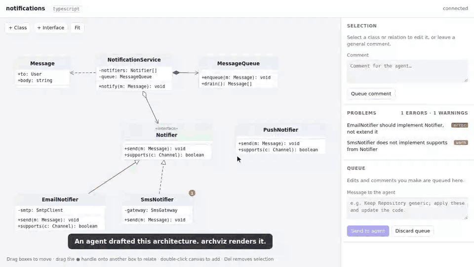

# archviz

Interactive class-architecture diagrams for AI coding agents.



The agent writes a small JSON model of your classes. archviz opens it in the browser as an editable UML class diagram. You drag classes around, make a class an interface or abstract, draw inheritance, edit members and leave comments. Your edits go into a queue, and **Send** hands them back to the agent. The agent updates the model and the diagram reloads with the changes highlighted.

Best-practice checks run while you edit: inheritance cycles, interfaces extending classes, `extends` vs `implements`, multiple inheritance (TypeScript / Python rules), missing implementations, unused abstractions, deep hierarchies, god classes and fat interfaces.

No dependencies. Node 20+.

## Install

```sh
git clone https://github.com/gagrinasg/archviz.git
cd archviz && npm link      # puts `archviz` on your PATH
```

To teach Claude Code the workflow, install the skill:

```sh
mkdir -p ~/.claude/skills/archviz && cp SKILL.md ~/.claude/skills/archviz/
```

## Use

```sh
archviz check examples/shapes.json   # print rule violations
archviz open  examples/shapes.json   # open the editor in your browser
archviz poll  examples/shapes.json   # wait for Send, print the feedback JSON
```

In the editor:
- Drag a box to move it. Positions are saved to the file.
- Drag the ● handle onto another box and choose the relation type.
- Click a class or relation to edit it or comment on it. Double-click the canvas to add a class. Del removes the selection.

See [SKILL.md](SKILL.md) for the model schema and the feedback format.

## Contributing

Run `npm test` for the tests. Commits are scanned for secrets with [gitleaks](https://github.com/gitleaks/gitleaks):

```sh
pip install pre-commit && pre-commit install
```

## License

[MIT](LICENSE)
